

  

  

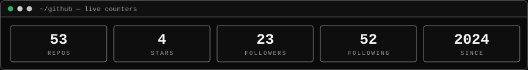


<table width="100%">
  <tr>
    <td width="50%"></td>
    <td width="50%"></td>
  </tr>
  <tr>
    <td width="50%"></td>
    <td width="50%"></td>
  </tr>
</table>


<!--FEATURED:START-->
<table width="100%">
  <tr>
    <td width="50%"><a href="https://github.com/deekshith-b48/ZeroHack">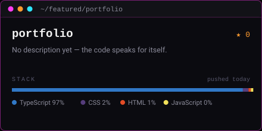</a></td>
    <td width="50%"><a href="https://github.com/deekshith-b48/Daily-LeetCode">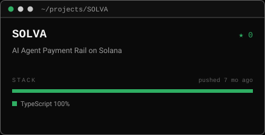</a></td>
  </tr>
  <tr>
    <td width="50%"><a href="https://github.com/deekshith-b48/poligap-kroolo">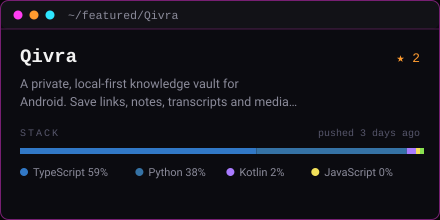</a></td>
    <td width="50%"><a href="https://github.com/deekshith-b48/Master-Software-Engineering">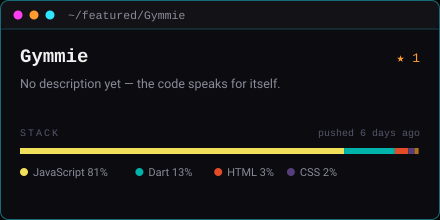</a></td>
  </tr>
</table>

Pinned repositories · refreshed automatically every day

<!--FEATURED:END-->


<!--LATEST:START-->

<a href="https://github.com/deekshith-b48/Daily-LeetCode">Daily-LeetCode</a> · <a href="https://github.com/deekshith-b48/Qivra">Qivra</a> · <a href="https://github.com/deekshith-b48/Gymmie">Gymmie</a> · <a href="https://github.com/deekshith-b48/NoLava">NoLava</a> · <a href="https://github.com/deekshith-b48/PlanBee">PlanBee</a> · <a href="https://github.com/deekshith-b48/projectx">projectx</a>

<!--LATEST:END-->



  
  <a href="https://github.com/deekshith-b48">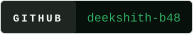</a>
  <a href="https://linkedin.com/in/deekshithb48">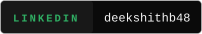</a>
  <a href="https://x.com/deekshith_b48">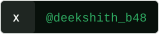</a>
  <a href="https://leetcode.com/deekshith_b48/">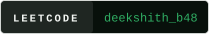</a>
  

  <picture>
    <source media="(prefers-color-scheme: dark)" srcset="https://raw.githubusercontent.com/deekshith-b48/deekshith-b48/output/github-contribution-grid-snake-dark.svg">
    <source media="(prefers-color-scheme: light)" srcset="https://raw.githubusercontent.com/deekshith-b48/deekshith-b48/output/github-contribution-grid-snake-dark.svg">
    
  </picture>

<code>cards marked live are rebuilt daily from the GitHub API by a GitHub Action</code>

