  

  
  
  
  

  
  
  

<h2 align="center">⚡ TECH STACK</h2>

<table>
  <tr>
    <td width="150" align="right"><b><code>Languages</code></b></td>
    <td>       </td>
  </tr>
  <tr>
    <td width="150" align="right"><b><code>Frontend</code></b></td>
    <td>     </td>
  </tr>
  <tr>
    <td width="150" align="right"><b><code>Backend &amp; DB</code></b></td>
    <td>      </td>
  </tr>
  <tr>
    <td width="150" align="right"><b><code>AI / ML</code></b></td>
    <td>      </td>
  </tr>
  <tr>
    <td width="150" align="right"><b><code>Web3</code></b></td>
    <td>     </td>
  </tr>
  <tr>
    <td width="150" align="right"><b><code>Cyber &amp; DevOps</code></b></td>
    <td>     </td>
  </tr>
  <tr>
    <td width="150" align="right"><b><code>Design</code></b></td>
    <td>    </td>
  </tr>
  <tr>
    <td width="150" align="right"><b><code>AI Platforms</code></b></td>
    <td>     </td>
  </tr>
</table>

  

<h2 align="center">🚀 FEATURED PROJECTS</h2>

<!--FEATURED:START-->
<table>
  <tr>
    <td width="50%"></td>
    <td width="50%"></td>
  </tr>
  <tr>
    <td width="50%"></td>
    <td width="50%"></td>
  </tr>
</table>

Most recently updated repositories · refreshed automatically every day

<!--FEATURED:END-->

<h2 align="center">🛰️ LATEST REPOS</h2>

<!--LATEST:START-->

<a href="https://github.com/deekshith-b48/portfolio">portfolio</a> · <a href="https://github.com/deekshith-b48/Daily-LeetCode">Daily-LeetCode</a> · <a href="https://github.com/deekshith-b48/Qivra">Qivra</a> · <a href="https://github.com/deekshith-b48/Gymmie">Gymmie</a> · <a href="https://github.com/deekshith-b48/NoLava">NoLava</a> · <a href="https://github.com/deekshith-b48/PlanBee">PlanBee</a>

<!--LATEST:END-->

  

<h2 align="center">📡 GITHUB ANALYTICS</h2>

  
  

  

  

  <picture>
    <source media="(prefers-color-scheme: dark)" srcset="https://raw.githubusercontent.com/deekshith-b48/deekshith-b48/output/github-contribution-grid-snake-dark.svg">
    <source media="(prefers-color-scheme: light)" srcset="https://raw.githubusercontent.com/deekshith-b48/deekshith-b48/output/github-contribution-grid-snake-dark.svg">
    
  </picture>

<h2 align="center">💻 CODING PROFILES &amp; CONTACT</h2>

  
  
  
  
  
  

<code>sections above marked “live” refresh automatically — repo cards and stats are rebuilt daily by a GitHub Action</code>

